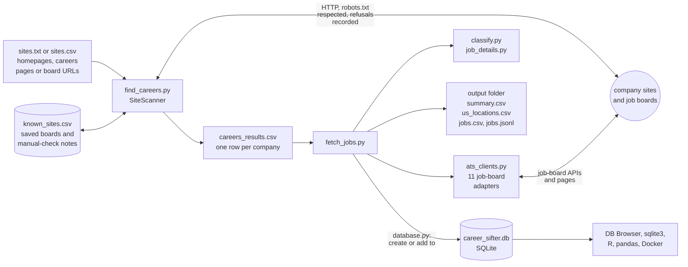
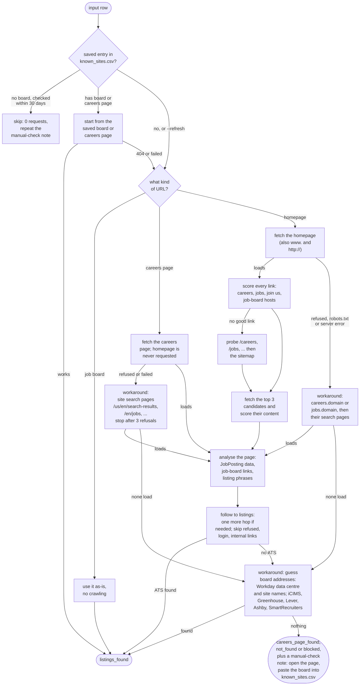
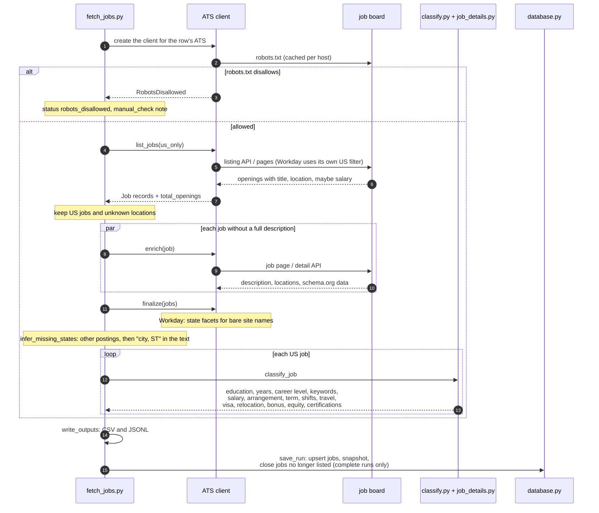
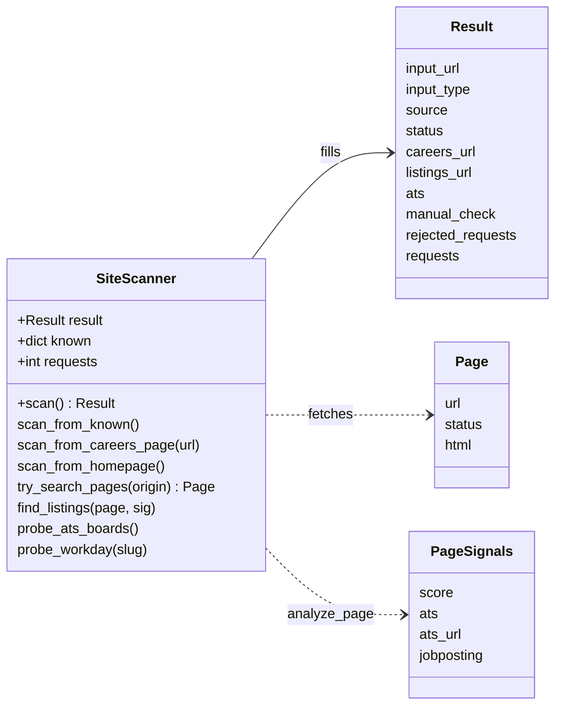
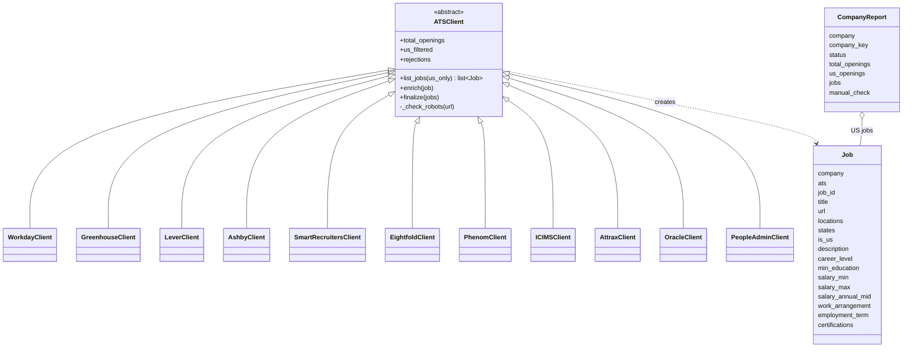
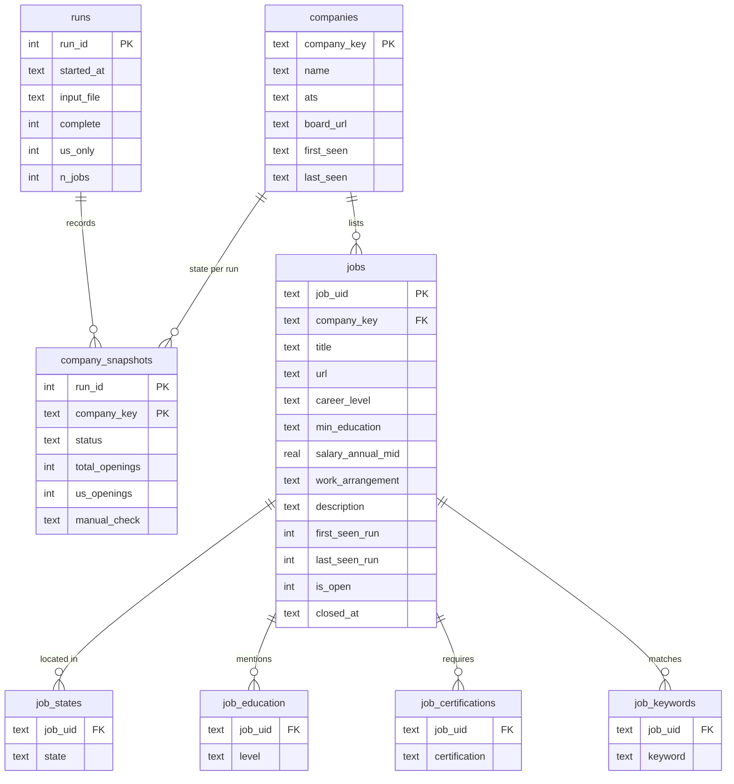
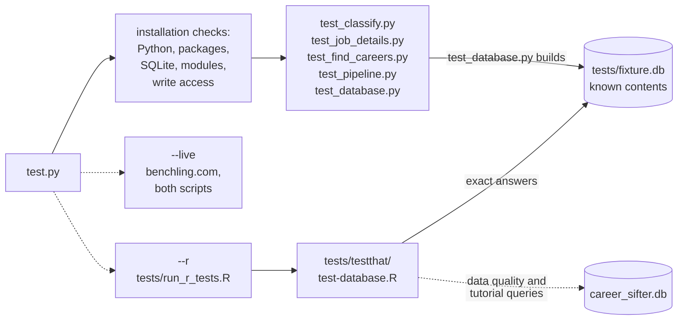

# Architecture

Diagrams of how Career Sifter is put together. They are written in
[Mermaid](https://mermaid.js.org/), which GitHub draws automatically. Edit the text to update
them.

1. [System overview](#1-system-overview)
2. [Finding the job board: entry paths and workarounds](#2-finding-the-job-board-entry-paths-and-workarounds)
3. [Collecting one company's jobs](#3-collecting-one-companys-jobs)
4. [Classes](#4-classes)
5. [Database tables](#5-database-tables)
6. [Tests](#6-tests)

---

## 1. System overview

Two scripts run one after the other. `find_careers.py` turns a list of websites into job-board
addresses. `fetch_jobs.py` reads the openings from those boards, tags them, and writes CSV/JSONL
files and the SQLite database.

## 2. Finding the job board: entry paths and workarounds

What `SiteScanner.scan()` does for one input row. Every path ends in a status
(`listings_found`, `careers_page_found`, `not_found`, `blocked`, `error`), a `manual_check`
note when a person needs to look, and an update to `known_sites.csv`.

## 3. Collecting one company's jobs

What `fetch_jobs.process_company()` does for one row of `careers_results.csv`. Companies run in
parallel (`--workers`); within a company, job pages are fetched in parallel (`--detail-workers`).

## 4. Classes

The main classes and how they relate. `SiteScanner` (in `find_careers.py`) produces a `Result`
per input row. Each `ATSClient` subclass turns one kind of job board into `Job` records, which
`fetch_jobs.py` groups into a `CompanyReport`.

### 4a. Finding the board (`find_careers.py`)

### 4b. Collecting jobs (`ats_clients.py`, `fetch_jobs.py`)

How each adapter reads its board:

| Adapter | Reads | Notes |
|---|---|---|
| Workday | `/wday/cxs/.../jobs` JSON | built-in US filter; state facets for bare site names |
| Greenhouse, Lever, Ashby | public board APIs | Lever/Ashby pay fields used directly |
| SmartRecruiters | public postings API | its robots.txt disallows the API, so it is skipped by default |
| Eightfold | `/api/pcsx` | its robots.txt disallows the API, so it is skipped by default |
| Phenom | JSON embedded in search pages (`phApp.ddo`) | career site on the company's domain |
| iCIMS | classic portal pages + schema.org, or career-site `/api/jobs` | follows portal → career-site redirects |
| Attrax | `/<lang>/jobs` tiles + schema.org | site's own level, salary, workplace type |
| Oracle Recruiting Cloud | `recruitingCE` REST API | vanity domains detected by path |
| PeopleAdmin | `/postings/search.atom` + field tables | its default robots.txt disallows scripts |

## 5. Database tables

`career_sifter.db`, created on the first run and added to afterwards. `jobs` has every column of
`jobs.csv` plus the description and tracking columns (only the main ones are shown). Views:
`v_open_jobs` (`is_open = 1`) and `v_latest_snapshots`.

## 6. Tests

`python test.py` checks the installation, then runs every `test_*.py` file. It builds
`tests/fixture.db`, which the R tests use for exact answers. `--live` and `--r` add the
internet and R checks.

